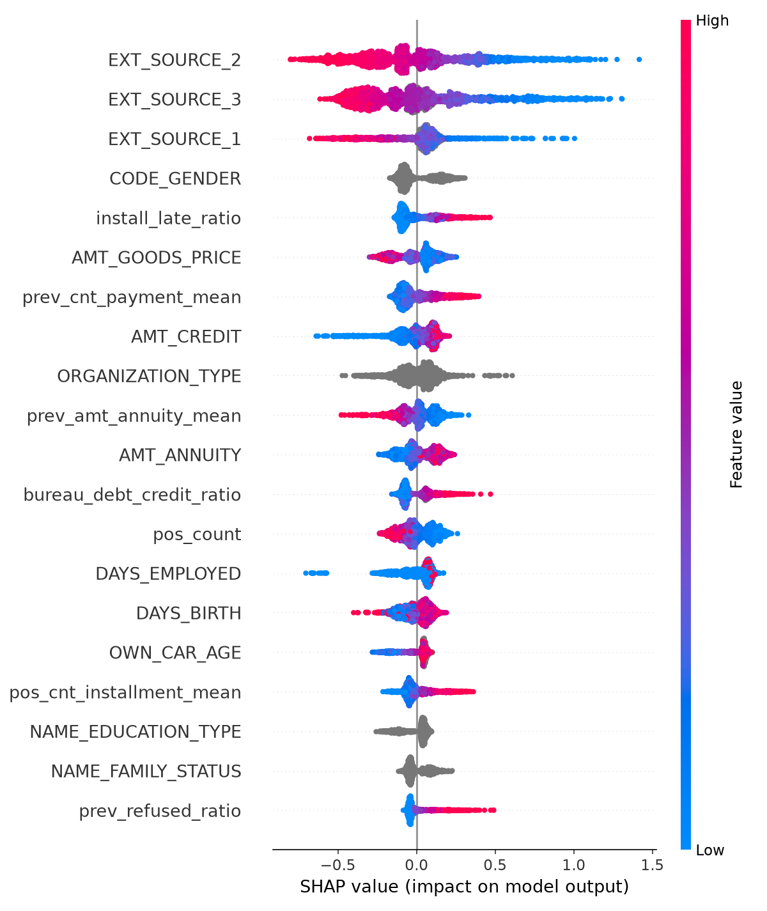

# Credit Default Risk Scoring
 
Predicting loan default on the Home Credit Default Risk dataset with LightGBM, explaining each prediction with SHAP, and serving the model through a FastAPI endpoint.
 
## Overview
 
Lenders need to estimate how likely an applicant is to default, and they need to be able to explain that estimate. This project builds a default-risk model on real loan data, compares it against simple baselines, checks what drives its predictions, removes a protected attribute (gender) from the final model, and wraps the result in an API that returns a probability together with the main factors behind it.
 
## Dataset
 
- **Source:** Kaggle competition [Home Credit Default Risk](https://www.kaggle.com/c/home-credit-default-risk). The data is not included in this repository (size and competition terms). To reproduce the work, join the competition on Kaggle, download the files and place the CSVs in a `data/` folder.
- **Main table:** `application_train.csv`, 307,511 applicants and 122 columns. The target is `TARGET` (1 = default). The default rate is 8.07%, so the classes are strongly imbalanced.
- **Auxiliary tables:** `bureau`, `previous_application`, `installments_payments`, `POS_CASH_balance` and `credit_card_balance`. Each one has many rows per applicant, so each was aggregated to one row per applicant (counts, means, maxima and a few ratios) before being joined to the main table. `bureau_balance` was not used.
## Approach
 
1. **Split.** Stratified 80/20 split with `random_state=42`: 246,008 training rows and 61,503 validation rows, with the same 8.07% default rate in both.
2. **Baselines.** A dummy classifier (the floor) and a logistic regression with median imputation, scaling, one-hot encoding and `class_weight='balanced'`.
3. **LightGBM.** Missing values and categorical columns are handled natively by the model. A first version using `scale_pos_weight` stopped improving after one boosting round and scored 0.7173 AUC, below the logistic regression. Removing it and adding regularisation (`min_child_samples`, L1/L2 penalties, row and column subsampling) fixed this: best iteration 531, AUC 0.7618.
4. **Feature engineering.** Aggregates from the five auxiliary tables, plus ratios such as `bureau_debt_credit_ratio`, `prev_refused_ratio`, `install_late_ratio` and `cc_utilization`. Each table was added one at a time so its contribution could be measured.
5. **Tuning.** Optuna, 25 trials, 3-fold cross-validation on an 80,000-row stratified sample to keep runtime manageable, then one retraining on the full training set with the best parameters.
6. **Explainability.** SHAP values for global importance and for individual predictions.
7. **Fairness check.** Gender removed from the final model (see below).
## Results
 
Metric: ROC AUC on the validation split.
 
| Model | AUC |
|---|---|
| Dummy baseline | 0.5016 |
| Logistic regression | 0.7483 |
| LightGBM, application table only | 0.7618 |
| + `bureau` | 0.7649 |
| + `previous_application` | 0.7717 |
| + `installments_payments` | 0.7771 |
| + `POS_CASH_balance` and `credit_card_balance` | 0.7810 |
| + hyperparameter tuning | 0.7819 |
| **Final model** (no `CODE_GENDER`, `DAYS_EMPLOYED` placeholder handled) | **0.7793** |
 
Each auxiliary table added a smaller gain than the one before. Tuning added only 0.0009, which suggests the initial regularised parameters were already close to a good setting.
 
The drop from 0.7819 to 0.7793 combines two changes (removing gender and handling the `DAYS_EMPLOYED` placeholder), so it is not a clean measure of what removing gender alone costs.
 
## What the model relies on
 

 
- `EXT_SOURCE_1`, `EXT_SOURCE_2` and `EXT_SOURCE_3` (external credit scores supplied in the data) dominate the SHAP ranking. Low scores push the predicted risk up.
- `ORGANIZATION_TYPE` ranked first by LightGBM's split-count importance but only ninth by SHAP. Split counts favour categorical columns with many values (58 here), so SHAP gives the more reliable picture.
- `install_late_ratio`, the share of past instalments paid late, is one of the strongest engineered features, and higher values clearly push risk up.
- Days-past-due features carried almost no signal. In `bureau`, 99.75% of records show zero overdue days, so there is little variation to learn from.
- Part of the bureau signal probably overlaps with `EXT_SOURCE`, which would explain its small gain. This is a hypothesis; it was not tested.
Example of an explanation for one applicant:
 

 
## Data quality
 
`DAYS_EMPLOYED` contains the placeholder value 365243 for 18.26% of validation applicants. It was replaced with a missing value, and a binary column `is_days_employed_anomaly` keeps the information that the value was a placeholder.
 
## Fairness
 
In one explanation of an individual applicant, `CODE_GENDER` was the single largest contributor. Gender is a protected attribute in credit decisions in many jurisdictions (for example under the US Equal Credit Opportunity Act), and a model could learn historical bias from it. It was therefore removed from the final model.
 
Dropping a column does not remove proxy effects from correlated features. No analysis of proxies or of performance across groups has been done, so this should be read as a first step, not a fairness audit.
 
## API
 
`main.py` loads the saved model once at startup and exposes one endpoint.
 
- `POST /predict` takes one applicant's features as JSON and returns:
  - `default_probability`: predicted probability of default
  - `risk_level`: `High` above 0.15, `Medium` above 0.08, otherwise `Low`
  - `top_factors`: the five features with the largest SHAP impact for that applicant (values are in log-odds)
- Interactive documentation is generated by FastAPI at `/docs`.
The risk-level thresholds are illustrative round numbers, not calibrated cut-offs.
 
## Run it yourself
 
```bash
git clone https://github.com/sachaju/credit-risk-scoring.git
cd credit-risk-scoring
python -m venv venv
venv\Scripts\activate          # Windows
# source venv/bin/activate     # Mac / Linux
pip install -r requirements.txt
```
 
To rerun the analysis, put the Kaggle CSVs in `data/` and run `01_explore.ipynb`.
 
To start the API with the saved model:
 
```bash
uvicorn main:app --reload
```
 
Then open `http://127.0.0.1:8000/docs`.
 
## Repository contents
 
| File | Purpose |
|---|---|
| `01_explore.ipynb` | Exploration, feature engineering, modelling, tuning and SHAP analysis |
| `main.py` | FastAPI application |
| `model.pkl` | Trained LightGBM model (final version) |
| `categorical_features.pkl` | Names of the categorical columns the model expects |
| `feature_columns.pkl` | Column order the model was trained with |
| `requirements.txt` | Pinned library versions |
| `shap_*.png` | SHAP figures used in this README |
 
## Limitations
 
- The validation split was used repeatedly to decide which tables to keep and how to set parameters. There is no separate untouched test set, so the reported AUC is probably slightly optimistic.
- Predicted probabilities have not been checked for calibration.
- The data comes from one lender and one period. Performance on other populations or later years is unknown, and there is no drift monitoring.
- The `.pkl` files only load correctly with the library versions in `requirements.txt`.
## Next steps
 
- Package the API with Docker and deploy it publicly.
- Add tests for the API.
- Describe how drift monitoring and retraining would work in production.
## Author
 
Sacha, [github.com/sachaju](https://github.com/sachaju)
 
Home Credit data is subject to the terms of the Kaggle competition and is not redistributed here.
